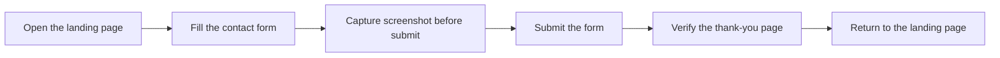
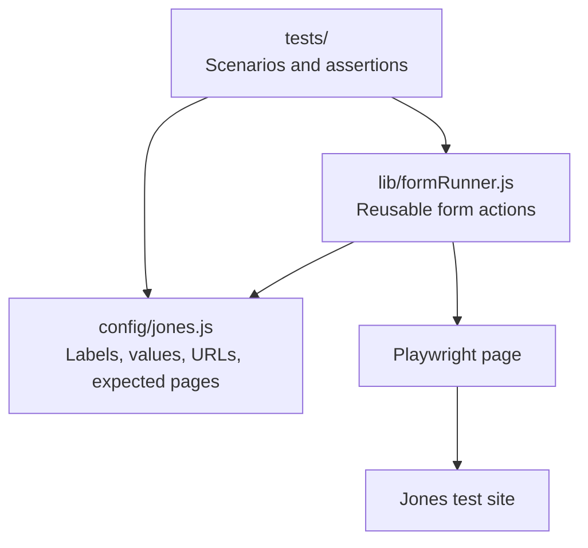

# Jones Contact Form Automation

> A small Playwright project built one useful layer at a time: first prove the page is reachable, then automate the real user journey, cover invalid input, and run the suite automatically.

This repository is an implementation of the contact-form portion of the Jones Automation exercise. It tests the live page at <https://test.netlify.app/> with Playwright and Chromium. The test data is fictional.

## The journey under test



The suite checks both successful submissions and browser-native validation failures. It also verifies that optional fields can stay blank.

## Coverage

| Scenario | What it verifies |
| --- | --- |
| Landing page smoke test | The target page loads and its main heading is visible. |
| Complete contact form | All fields accept the configured values, the bonus employee range is selected, and a screenshot is captured before submission. |
| Thank-you and return-home flow | Submission reaches the expected thank-you page, logs a confirmation message, and the return link gets back home. |
| Optional fields omitted | Company and Website can remain blank and the employee selector can stay at its default. |
| Required fields missing | Each required field blocks submission until it is filled. |
| Invalid email | A malformed email is rejected; correcting it allows submission. |
| Invalid optional website | A malformed website URL is rejected even though the field is optional; correcting it allows submission. |

## How the code is organized

The tests describe the Jones scenarios. Jones-specific page details and test data live in configuration. Small helpers hold the repeated form actions and success checks.



| Path | Responsibility |
| --- | --- |
| `config/jones.js` | Target URL, accessible field labels, fictional form values, employee options, and expected page details. |
| `lib/formRunner.js` | Fill configured text fields, click submit, and verify successful navigation. |
| `tests/` | Keep each user journey and validation scenario visible and focused. |
| `.github/workflows/playwright.yml` | Install the browser, run tests in GitHub Actions, and publish run artifacts. |

This is intentionally scoped to one site. If another similar form needs testing, its labels, values, and expected pages can be configured separately; the test scenario can use the same helpers where the behavior matches.

## How the project evolved

Each commit tackled one clear step without building a general framework up front.

| Commit | Change | Why it came next |
| --- | --- | --- |
| [`ccffb78`](https://github.com/MosheT01/Jones-Automation/commit/ccffb78) | Initialize Playwright and add a website smoke test. | Confirm the browser can reach the target page and recognize it. |
| [`2e91b0d`](https://github.com/MosheT01/Jones-Automation/commit/2e91b0d) | Add the contact-form journey and optional-field coverage. | Exercise the assignment’s actual workflow, including the thank-you page and return-home link. |
| [`5f46182`](https://github.com/MosheT01/Jones-Automation/commit/5f46182) | Separate site configuration from form execution. | Keep site details out of repeated form operations so the flow is easier to read and adapt. |
| [`698ace8`](https://github.com/MosheT01/Jones-Automation/commit/698ace8) | Add validation coverage and failure diagnostics. | Check how the form responds to missing and malformed input, and make failures easier to inspect. |
| [`b8bcd74`](https://github.com/MosheT01/Jones-Automation/commit/b8bcd74) | Add scheduled Playwright CI workflow. | Run the suite on pushes, pull requests, and a daily schedule. This commit is on [PR #1](https://github.com/MosheT01/Jones-Automation/pull/1); the daily schedule starts after it is merged to `main`. |

## Run it locally

### Requirements

- Node.js 18 or newer
- npm

### Install

```sh
npm ci
npx playwright install chromium
```

### Run the suite

```sh
npm test
```

To watch Chromium while the tests run:

```sh
npm run test:headed
```

## Reports and failure diagnostics

After a run, open the HTML report with:

```sh
npx playwright show-report
```

The complete-flow screenshot is captured **before** submission and attached to the report. On failure, Playwright retains a screenshot and trace in `test-results/`. Both `playwright-report/` and `test-results/` are generated output and are ignored by Git.

## GitHub Actions

The workflow runs on:

- Pushes to `main`
- Pull requests targeting `main`
- A daily schedule at **06:00 UTC**
- Manual dispatch from the repository’s **Actions** tab

Each run uploads the HTML report as an artifact for 14 days. Failed runs also upload screenshots and traces. The daily schedule runs from the default branch after the workflow is merged to `main`.
